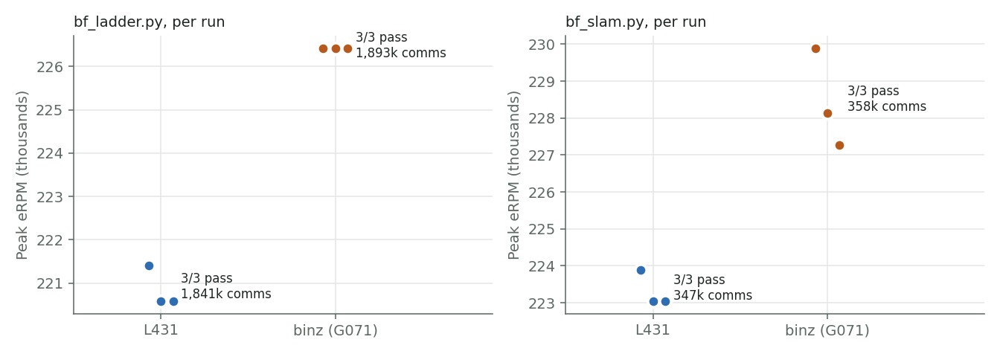
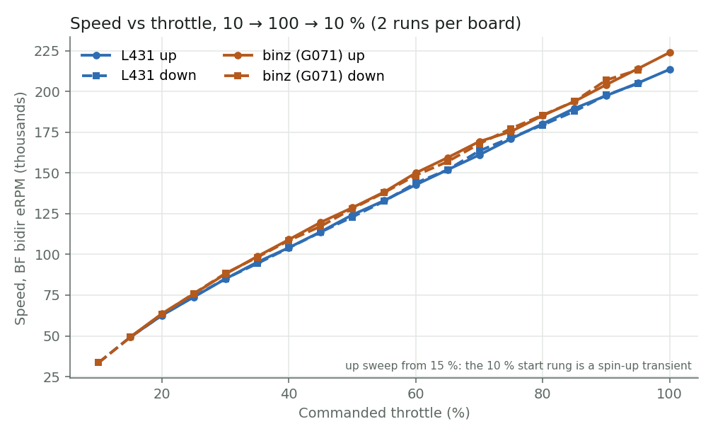
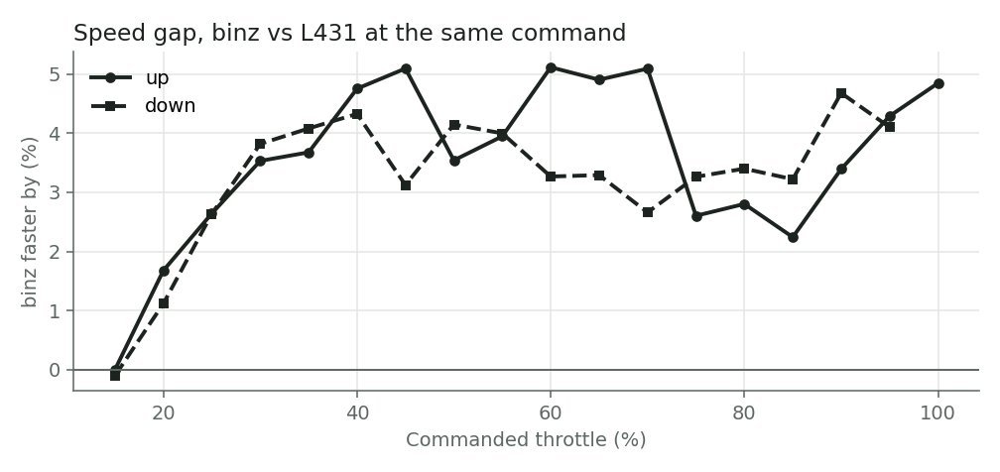
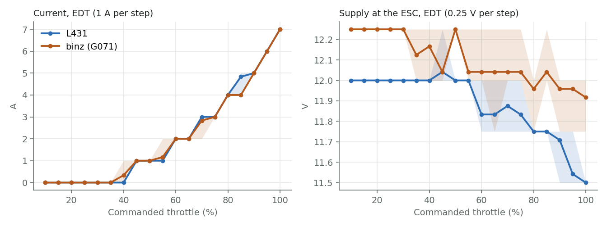
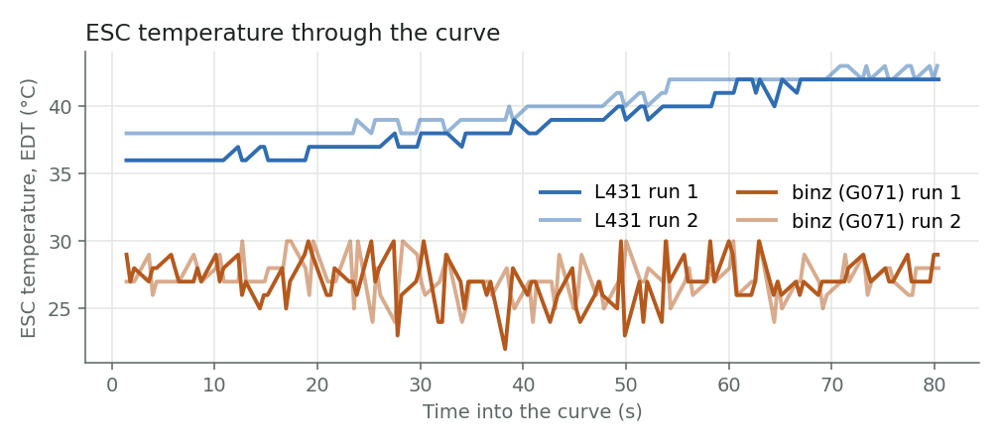
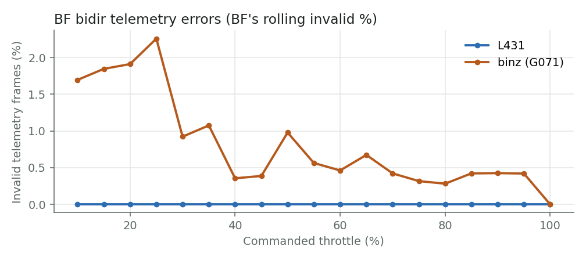
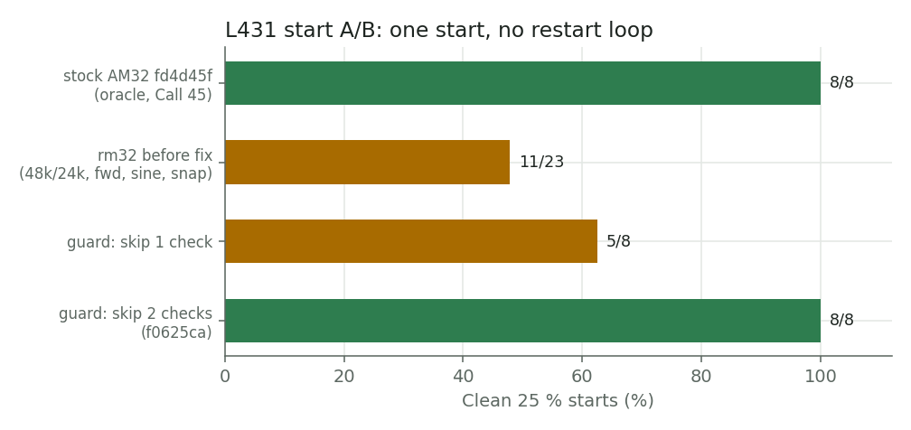

# Issue #7: L431 and G071 side by side on one commit

FC bench, 2026-10-27. Both ESCs ran the same rm32 source: `devel d30c3d3`,
whose firmware tree is identical to `f0625ca`. They drove the same motor,
switched between boards by the relay. Betaflight on an F411 drove both, over
DSHOT300 (unidirectional for the ladder/slam, bidirectional for the curves).
Supply: 3S2P pack in parallel with the PSU. Every test ran as its own
command, alternating boards.

The same report with identical content is in `index.html` and published at
https://claude.ai/artifact/HhU21C4nWpHjVqyPZuSgyU. Figures are regenerated
by `scripts/plot_issue7.py` from `captures/gc/` (local, gitignored).

## Verdict

**12/12 pass.** Every `bf_ladder.py` and `bf_slam.py` run on both boards
held one start (`starts=1`) with zero desyncs (`dsy=0`). No resets happened
during any test, and the bench guard never fired. A pass needs more than 500k
locked commutations on a ladder and more than 100k on a slam. Verdicts come
from the `[run]` summary the ESC prints after each stop. The four
`bf_curve.py` runs (two per board) also passed by the same rule.

| Board | Ladder comms (mean of 3) | Ladder peak eRPM | Slam comms | Slam peak eRPM | Shortest e-period |
|---|---|---|---|---|---|
| L431 (STM32L431, 80 MHz, 48 kHz carrier, motor 0) | 1,841,016 | 220,859 | 346,917 | 223,325 | 268–272 us |
| binz (NUCLEO-G071RB + DRV8304H, 64 MHz, 48 kHz, motor 1) | 1,893,486 | 226,415 | 357,671 | 228,431 | 261–265 us |

| Board | Test | # | Starts | Dsy | Comms | Peak eRPM | Min e-period us | Session ms |
|---|---|---|---|---|---|---|---|---|
| L431 | ladder | 1 | 1 | 0 | 1,843,118 | 221,402 | 271 | 139,325 |
| binz | ladder | 1 | 1 | 0 | 1,893,873 | 226,415 | 265 | 140,125 |
| L431 | ladder | 2 | 1 | 0 | 1,838,634 | 220,588 | 272 | 139,356 |
| binz | ladder | 2 | 1 | 0 | 1,895,052 | 226,415 | 265 | 140,201 |
| L431 | ladder | 3 | 1 | 0 | 1,841,295 | 220,588 | 272 | 139,257 |
| binz | ladder | 3 | 1 | 0 | 1,891,532 | 226,415 | 265 | 139,740 |
| L431 | slam | 1 | 1 | 0 | 347,639 | 223,880 | 268 | 29,608 |
| binz | slam | 1 | 1 | 0 | 359,506 | 229,885 | 261 | 29,331 |
| L431 | slam | 2 | 1 | 0 | 346,333 | 223,048 | 269 | 29,602 |
| binz | slam | 2 | 1 | 0 | 355,948 | 228,136 | 263 | 29,149 |
| L431 | slam | 3 | 1 | 0 | 346,779 | 223,048 | 269 | 29,573 |
| binz | slam | 3 | 1 | 0 | 357,559 | 227,272 | 264 | 29,211 |

Ladder: 10 → 100 → 10% in 2% steps, 1.5 s per step, never back to zero.
Slam: 5 s at 10%, then three cycles of 100% → 10% → 100% → 10%.

## Throttle curves

`scripts/bf_curve.py` steps each board 10 → 100 → 10% in 5% steps, two runs
per board. At every step it takes three samples of Betaflight's own
bidirectional eRPM and EDT telemetry (temperature, voltage, current), read
with `dshot_telemetry_info` in the same CLI session that drives `motor N`.
The x-axis is the commanded throttle. The ESC's internal duty isn't visible
from the FC, and the ESC never prints while the motor is powered. One short
MSP arm first primes EDT, because Betaflight only sends the EDT-enable
command at arm. Each run is one session: 1.03M (L431) and 1.06M (binz)
locked commutations, one start, zero desyncs.

Speed tracks throttle almost linearly on both boards, from 49k eRPM at 15%
to 214k (L431) and 224k (binz) at 100%. The up and down sweeps coincide, so
there is no hysteresis and no lost lock coming down. The 10% up point is left
out because the motor is still spinning up on that first step.

binz runs faster at the same command, and the gap opens with throttle: none
at 15%, 2.5% at 25%, then 2.2–5.1% from 30% to the top. Up and down sweeps
agree to within about 1.5 points. The cause hasn't been measured. Candidates
are power-stage differences only: gate driver and FETs, dead time (L431 about
560 ns, binz about 405 ns), and the leads through the relay.

Current is the same on both boards at EDT's 1 A resolution, reaching 7 A at
100%. The supply readings differ by 0.22 V even near idle (12.00 vs 12.22 V)
on one pack and PSU. That points to a calibration offset between the boards'
voltage dividers, so these readings can't explain the speed gap. Measured
sag at 7 A is 0.5 V (L431) and 0.3 V (binz), only one or two 0.25 V EDT
steps.

The L431 warms steadily, from 36 to 43 C over 80 s. binz reads 22–30 C with
±3 C jitter from sample to sample and no trend. It looks like a noisy
temperature measurement on the G071 side; look at it before trusting EDT
temperature on that chip.

Betaflight's telemetry error rate is 0% on the L431 at every step and
0.3–2.3% on binz, worst below 30% throttle. This is the known binz telemetry
item, now measured across the whole range.

## What it took to get here

The first L431 runs on this bench choked on about half of all 25% starts: a
restart loop with about 500 starts and 750 desyncs per hold. binz never did
this. Stock AM32 (fd4d45f) on the same L431, motor, FC and config started
cleanly 8 times out of 8, so the cause had to be in rm32.

- **Ruled out:** carrier frequency (24 kHz also choked), spin direction, sine
  start, and the generic-core refactor (the pre-refactor baseline choked too).
  The duty matched AM32 at every check.
- **Mechanism:** a snapshot of the desync detector's inputs, now printed in
  `[run]` as `first=` and `hist=`, showed the first desync always fired at
  zero-cross 24, the first check in interrupt mode. rm32 polls BEMF on its
  20 kHz tick, not at AM32's main-loop rate, so commutations in polling mode
  run late. At the switch to interrupt mode the timing snaps to correct, the
  next revolution is about 35% faster, and `|last - avg| > avg/2` reads that
  jump as a desync.
- **Fix (`f0625ca`, Call 45):** the detector compares only two revolutions
  that both ran fully in interrupt mode. Counted from the logs: before the
  fix, 11 of 23 starts were clean across every variant tried. Skipping one
  check gave 5 of 8, and skipping two checks gave 8 of 8. This is a recorded
  divergence from AM32 that exists only because of the different polling
  rate.
- **Protocol matrix on `f0625ca`:** DSHOT600, DSHOT150, DSHOT300, PWM and
  bidirectional DSHOT300 all pass. Each leg made one start, reached closed
  loop with zero desyncs, and peaked at about 75k eRPM. On the bidirectional
  leg Betaflight read 73.7k eRPM with 0% invalid telemetry. `gc-s7-dshot` is
  merged into devel.

## EDT (Call 44)

Temperature, voltage and current decode with `dshot_edt = ON`. The cause of
the earlier failure was an FC setting, not code. `feature ESC_SENSOR`, left
on since the 2026-08-02 KISS test, stops Betaflight from sending the
EDT-enable command at arm (`core.c:587`). It also replaces the MSP
temperature, voltage and current with values from the serial sensor, which
is no longer wired.

Arm-and-spin runs at 25%, read with `dshot_telemetry_info`:
- **Stock Betaflight, rm32 `f0625ca`:** `ESC_SENSOR` on gave eRPM only
  (`R----`); off gave `RTVCS` (temperature, voltage and current all
  decoding). The order was off, on, off, on.
- **Known-good tag `pre-main-merge-20260816` on the L431:** the same split.

The FC is now set to `ESC_SENSOR` off, `dshot_edt = ON`, `dshot_bidir = ON`.

## Open items

- **binz startup decode:** in 2 of 6 sessions, binz came up after the FC
  reboot with 0% DShot decode. It logged about 500 CRC failures, with a stale
  16-bit first capture interval (about 62,350) in front of clean pulse
  widths. After one signal-timeout reset it decoded normally. This looks like
  the one-edge capture misalignment problem. It happened before the test
  window both times, so no verdict is affected.
- **binz telemetry:** 0.3–2.3% invalid telemetry and a jittery EDT
  temperature (above).
- **L431 SWD:** needs a slow clock (`--speed 100`) since the 2026-10-27 power
  cycle.
